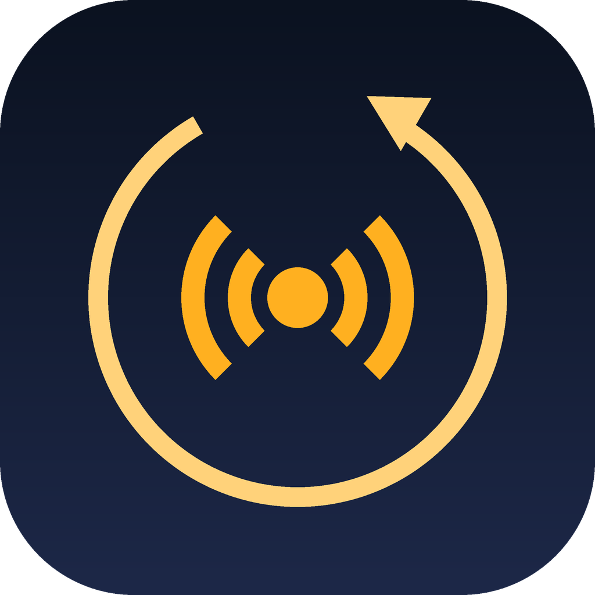

<p align="center"></p>

# Sintonia — player de rádio online com volta de 30 minutos

App Flutter para ouvir rádios online sem cortes. Busca rádios num catálogo
aberto, reconecta sozinho quando a internet oscila e grava os últimos
30 minutos no próprio celular, para voltar e ouvir de novo.

> *English:* Flutter internet-radio player with gapless auto-reconnect and a
> 30-minute local timeshift buffer. Built spec-first (Spec-Driven Development).

## Por que existe
Os players que eu usava falhavam de três jeitos: a rádio sumia do catálogo, a
conexão caía depois de algumas músicas e era preciso reconectar na mão, e a
qualidade alta cortava em algumas redes. O Sintonia ataca os três.

## Recursos
- 🔎 Busca por nome ou gênero no catálogo aberto [Radio Browser](https://www.radio-browser.info), com filtro Brasil
- 🔁 **Reconexão invisível:** o player toca de um servidor local; a queda de rede não chega até ele
- ⏪ **Volta no tempo de até 30 minutos**, com barra, saltos de 30 s e botão "ao vivo"
- ⏸️ Pausa sem perder nada: a gravação continua enquanto está pausado
- 📶 **Qualidade reserva automática:** troca para um endereço de qualidade menor se o principal ficar cortando
- 🎵 Música atual (metadados ICY) e capa do álbum
- 🔒 Segundo plano, notificação e tela de bloqueio · ⏲️ timer para dormir · ❤️ favoritas · 🔗 rádio pelo endereço

## Como funciona
```
Rádio ──HTTP──▶ StreamRelay ──▶ TimeshiftBuffer (30 min, disco) ──▶ servidor local ──▶ player
                 (reconecta,                                          127.0.0.1
                  troca reserva)
```
Detalhes em [`specs/001-player-radio/plan.md`](specs/001-player-radio/plan.md).

## Desenvolvimento guiado por especificação (SDD)
Nenhum código entra sem especificação. Estrutura no padrão do
[Spec Kit](https://github.com/github/spec-kit):

Princípios do projeto: [`.specify/memory/constitution.md`](.specify/memory/constitution.md).

Cada funcionalidade ou correção tem sua pasta com especificação (`spec.md`),
plano técnico (`plan.md`) e tarefas ligadas aos requisitos (`tasks.md`):

| Especificação | Assunto |
|---|---|
| [`001-player-radio`](specs/001-player-radio/spec.md) | Player, busca no catálogo, volta de 30 minutos, favoritas, qualidade reserva |
| [`002-troca-de-rede`](specs/002-troca-de-rede/spec.md) | Troca de WiFi/5G sem atraso: emenda do áudio na reconexão |
| [`003-ligacao-e-pausa`](specs/003-ligacao-e-pausa/spec.md) | Ligação pausa e continua de onde parou |
| [`004-atraso-na-tela-e-diagnostico`](specs/004-atraso-na-tela-e-diagnostico/spec.md) | Barra de tempo estável, tela de diagnóstico, visual da barra |
| [`005-player-repete-pedido`](specs/005-player-repete-pedido/spec.md) | Rede travada não faz a música voltar no tempo |

As correções 002 a 005 nasceram de uso real; o plano de cada uma registra a
causa encontrada e o teste automatizado que a reproduz.

## Rodando
Requisitos: Flutter 3.32 ou superior e Android Studio.

1. Abra a pasta no Android Studio.
2. Rode **Pub get** (aviso no topo do `pubspec.yaml`).
3. Conecte o celular e rode `lib/main.dart`.

Testes do motor de áudio (sem precisar de celular): `flutter test`.

## Tecnologia
Flutter · Dart · just_audio · audio_service · audio_session · provider · shared_preferences

## Licença
[MIT](LICENSE) © 2026 Marcelo Glenski. Projeto pessoal, sem fins comerciais.
As rádios e seus conteúdos pertencem aos respectivos donos.
